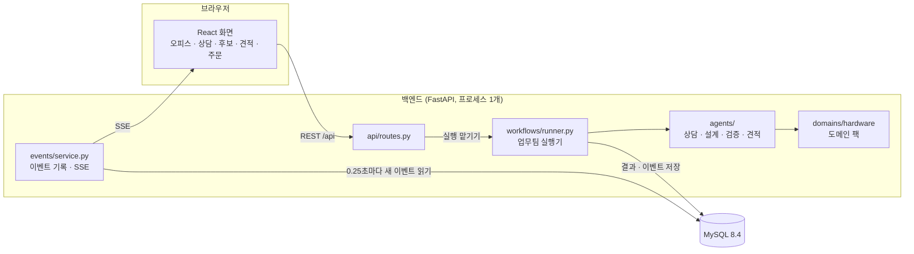
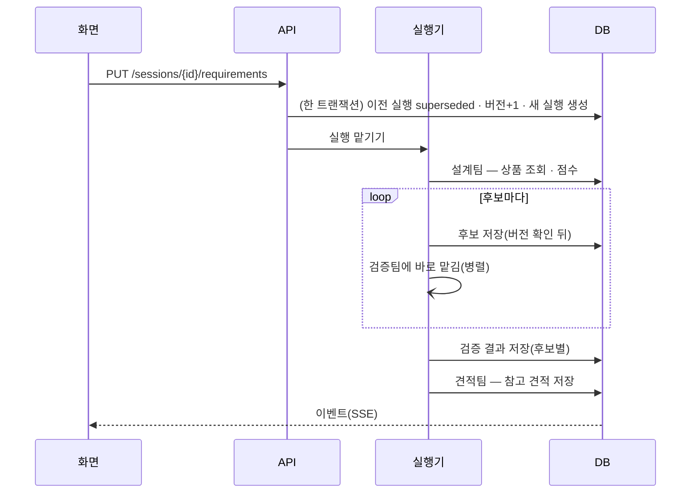
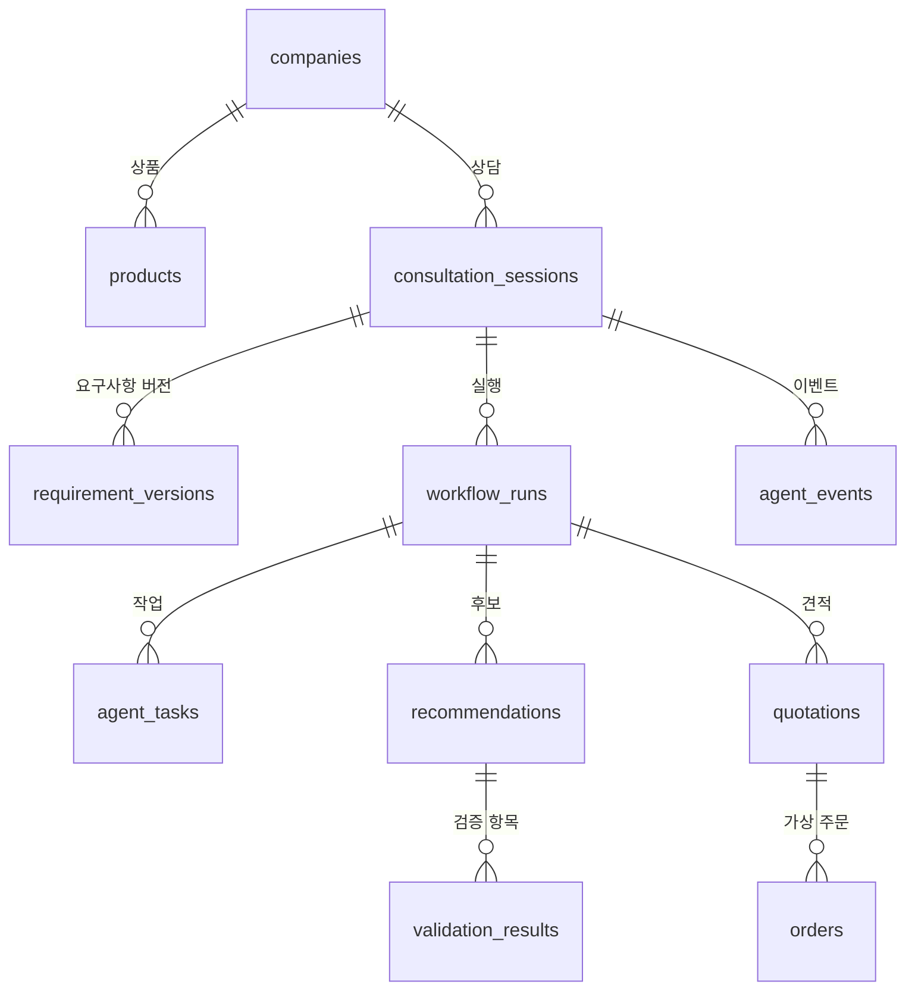

# 구조 설명 (ARCHITECTURE)

> 이 문서는 기존 Mock 앱의 기록입니다. 현재 로컬 DB의 설치·검사 방법은 [DB 작업 안내](DATA_PIPELINE.md)를 참고하세요.

BUILDWISE 가 어떻게 생겼는지, 팀이 함께 지키는 계약(API · 이벤트 · DB)이 무엇인지 정리한 문서입니다.
코드를 바꾸기 전에 해당 절을 먼저 읽어 주세요.

## 1. 한눈에 보기

- 업무팀 4개는 **서버를 따로 두지 않고** 백엔드 한 프로세스 안의 모듈입니다.
- 화면 → 서버는 REST, 서버 → 화면은 SSE(Server-Sent Events) 한 방향 스트림입니다.
- **서버가 상태의 기준**입니다. 화면은 이벤트를 받아 그릴 뿐 상태를 만들지 않습니다.

## 2. 폴더 역할

| 폴더 | 역할 | 이런 일을 할 때 여기를 봅니다 |
|---|---|---|
| `backend/app/api/` | HTTP 엔드포인트(얇게) | 새 API 추가 |
| `backend/app/contracts/` | **공통 계약** — Pydantic 스키마 | 필드 · 상태값 확인/변경(절차 필요) |
| `backend/app/agents/` | 업무팀 로직(공통 엔진) | 추천 · 검증 · 견적 규칙 |
| `backend/app/workflows/` | 실행 순서 · 오래된 결과 차단 · 재시도 · 재시작 정리 | 업무 흐름 변경 |
| `backend/app/domains/hardware/` | 하드웨어 사양 스키마 · 조건 규칙 · 사용 목적 추론 | 새 상품 유형 · 호환성 규칙 |
| `backend/app/catalog/` | 공통 상품 형식 · 기업 데이터 적재 어댑터 | 새 기업 데이터 연결 |
| `backend/app/companies/` | 기업 · 판매 정책 | 배송비 · 할인 · 취급 유형 |
| `backend/app/consultation/` | 세션 · 요구사항 버전 · 조회 | 상담 상태 |
| `backend/app/events/` | 이벤트 기록 · 조회 · SSE | 실시간 표시 |
| `backend/app/quotations/` · `orders/` | 견적 조회 · 가상 주문 | 견적 · 주문 |
| `backend/app/db/` · `backend/migrations/` | 테이블 · 마이그레이션 | DB 변경 |
| `frontend/src/features/*` | 화면 기능별 컴포넌트 | 화면 작업 |
| `frontend/src/events/` | 이벤트 스트림(실제 · 가짜) | 실시간 연결 |
| `frontend/src/api/` | 자동 생성 타입 + API 클라이언트 | API 호출 |
| `contracts/` | 생성된 OpenAPI · 이벤트 스키마 | 계약 확인(직접 수정 금지) |
| `data/fixtures/` | 가상 견본 데이터 | 테스트 데이터 |

## 3. 실행 흐름

**오래된 결과 차단.** 실행기의 모든 저장은 `_guarded` 안에서 합니다.
세션 행을 `SELECT … FOR UPDATE` 로 잠그고 `current_requirement_version` 이 실행의 버전과 같을 때만 저장합니다.
다르면 `Superseded` 로 멈추고 아무것도 남기지 않습니다. 요구사항 변경(PUT)도 같은 행을 잠그므로 둘이 엇갈리지 않습니다.

**이벤트 순번.** 이벤트도 같은 잠금 안에서 `last_event_seq + 1` 로 번호를 받고 같은 트랜잭션에서 커밋합니다.
그래서 여러 검증 작업이 동시에 끝나도 순번에 빈 번호가 생기지 않고, 화면은 "마지막으로 받은 번호 다음" 만 받으면 됩니다.

**같은 요구사항이면 다시 실행하지 않음.** 직전 버전과 내용이 같으면 `changed: false` 를 돌려주고 끝냅니다.
(유형별로 일부 결과만 재사용하는 세밀한 재사용은 아직 없습니다 — 다음 단계 후보.)

**재시도 · 재시작.** 일시 오류(`TransientAgentError`)는 `BUILDWISE_MAX_RETRIES`(기본 2)번까지 다시 시도하고 `task.retrying` 이벤트를 남깁니다.
서버가 다시 켜지면 '진행 중'으로 남은 실행을 `failed`(코드 `SERVER_RESTART`, 재시도 가능)로 정리합니다. 화면의 **다시 시도** 버튼이 `POST /sessions/{id}/retry` 를 부릅니다.

> 서버 프로세스는 1개로 실행합니다(`--workers` 를 늘리지 않음). 실행 중인 작업을 이 프로세스의 스레드가 들고 있기 때문입니다.
> 여러 서버로 늘리려면 작업 큐(예: Redis · SQS)로 바꿔야 합니다 — 지금 범위 밖입니다.

## 4. API 계약 v0

실행 중 문서: http://localhost:8000/docs · 파일: [`contracts/openapi.json`](../contracts/openapi.json)

| 메서드 | 경로 | 하는 일 | 비고 |
|---|---|---|---|
| GET | `/api/health` | 서버 · DB 상태 | |
| GET | `/api/companies` | 기업 목록(취급 유형 · 정책) | |
| POST | `/api/sessions` | 상담 세션 만들기 | 헤더 `X-Company-Id` |
| GET | `/api/sessions/{id}` | 세션 현재 상태(요구사항 · 최신 실행 · 작업) | |
| PUT | `/api/sessions/{id}/requirements` | 요구사항 보내기/바꾸기 → 실행 시작 | 같은 내용이면 `changed:false` |
| POST | `/api/sessions/{id}/retry` | 현재 요구사항으로 다시 실행 | 진행 중이면 409 |
| GET | `/api/sessions/{id}/events?after=N` | N 다음 이벤트 목록 | 폴링 · 테스트용 |
| GET | `/api/sessions/{id}/events/stream?company_id=&after=` | 실시간 이벤트(SSE) | 브라우저 EventSource 는 헤더를 못 보내 쿼리로 |
| GET | `/api/sessions/{id}/recommendations` | 현재 버전 후보 + 검증 결과 | |
| GET | `/api/sessions/{id}/quotation` | 현재 버전 참고 견적 | 없으면 404 |
| POST | `/api/orders` | 가상 주문 | 헤더 `Idempotency-Key`(8~80자) 필수, 같은 키 재요청은 200 + 같은 주문 |
| GET | `/api/orders/{id}` | 주문 조회 | |

오류 형식은 `{"detail": "사람이 읽을 메시지"}` 입니다. 404 없음 · 409 상태 충돌 · 422 값 오류.

## 5. 이벤트 계약

파일: [`contracts/events.schema.json`](../contracts/events.schema.json)

| 필드 | 뜻 |
|---|---|
| `seq` | 세션 안 순번(1부터 빈틈없이) |
| `session_id` · `company_id` | 어느 상담 · 어느 기업 |
| `run_id` | 실행 id(요구사항 정리 이벤트는 null) |
| `requirement_version` | 어느 요구사항 버전의 이벤트인지 |
| `team` | `consultation` · `design` · `validation` · `quotation`, 실행 전체면 null |
| `type` | 아래 표 |
| `status` | 아래 표 |
| `occurred_at` | 발생 시각(UTC) |
| `message` | 화면에 보여 줄 한 줄 |
| `error` | `{code, message, retryable}` |
| `artifact` | 관련 산출물 `{kind, id}` — kind: requirements · recommendation · validation · quotation · order |
| `metrics` | 측정값(ms 등) |

| type | 언제 |
|---|---|
| `requirements.updated` | 상담팀이 요구사항 새 버전을 정리 |
| `run.started` · `run.completed` · `run.failed` · `run.needs_input` · `run.needs_revision` · `run.superseded` | 실행 전체 상태 |
| `task.started` · `task.progress` · `task.retrying` · `task.completed` · `task.failed` · `task.needs_input` | 업무팀 작업 상태 |
| `order.created` | 가상 주문 생성 |

| status | 화면 표시 |
|---|---|
| `pending` | 대기 |
| `running` | 진행 중 |
| `needs_input` | 고객 확인 필요(조건에 맞는 상품 없음 · 취급 안 하는 유형) |
| `needs_revision` | 재검토 필요(후보가 모두 검증 탈락) |
| `completed` | 완료 |
| `failed` | 실패(`error.retryable` 이면 다시 시도 가능) |
| `cancelled` | 취소 |
| `superseded` | 요구사항이 바뀌어 중단된 이전 요청 |

**화면 규칙**([`officeState.ts`](../frontend/src/features/office/officeState.ts)): 이미 받은 `seq` 는 무시, 현재 버전보다 오래된 이벤트는 반영 안 함,
새 버전 이벤트가 오면 업무팀 칸을 비우고 다시 그림. 검증팀처럼 작업이 여러 개면 모두 끝나야 '완료'.

## 6. DB

| 테이블 | 핵심 컬럼 | 메모 |
|---|---|---|
| `companies` | slug(유니크) · domain · source_format · policy(JSON) · is_test_data | 기업 = 테넌트 |
| `products` | company_id · sku(기업 안 유니크) · product_type · brand · model_name · price_amount · price_status · data_status · source_url · attributes(JSON) | 세부 사양만 JSON |
| `consultation_sessions` | company_id · current_requirement_version · last_event_seq | 잠금 기준 행 |
| `requirement_versions` | session_id + version(유니크) · payload(JSON) | 바뀔 때마다 새 행 |
| `workflow_runs` | session_id · requirement_version · status · first_candidate_ms | 버전당 실행(재시도 시 여러 개) |
| `agent_tasks` | run_id · team · status · attempt · duration_ms · error_code | 계측 |
| `agent_events` | session_id + seq(유니크) · type · status · error/artifact/metrics(JSON) | |
| `recommendations` | run_id · requirement_version · rank · product_snapshot(JSON) · status | 그때 상품 정보를 보존 |
| `validation_results` | recommendation_id · check_code · passed · severity | |
| `quotations` | run_id · items(JSON) · subtotal · shipping_fee · discount · total · valid_until | 참고 견적 |
| `orders` | company_id + idempotency_key(유니크) · quotation_id · status | 가상 주문 |

- 시각은 모두 UTC(마이크로초까지).
- 스키마 변경은 반드시 Alembic 마이그레이션으로 — 방법은 [TEAM_GUIDE.md](TEAM_GUIDE.md#db-컬럼을-추가해야-할-때).
- 견본 데이터 넣기: 백엔드 컨테이너가 켜질 때 `python -m app.seed` 가 자동으로 돕니다(이미 있으면 갱신).

## 7. 다른 기업에 붙이는 구조

같은 엔진에 **도메인 팩 · 데이터 적재 어댑터 · 판매 정책** 세 가지를 바꿔 끼웁니다.

| 바꾸는 것 | 위치 | 지금 있는 것 |
|---|---|---|
| 도메인 팩(상품 유형 · 사양 · 조건 규칙) | `backend/app/domains/` | `hardware` |
| 데이터 적재 어댑터(기업 데이터 형식 → 공통 형식) | `backend/app/catalog/loaders.py` | `public_json`(공통 형식 JSON), `company_csv`(CSV + 컬럼 매핑) |
| 판매 정책(취급 유형 · 배송비 · 할인 · 견적 유효기간) | `data/fixtures/companies.json` → `companies.policy` | 기업 2곳 |

같은 요구사항을 두 기업에 보내면 후보(카탈로그)와 견적(정책)이 달라지는 것을 테스트로 확인합니다
(`backend/tests/test_tenancy_and_catalogs.py`).

실제 기업 도입에는 이것 말고도 데이터 변환 · 접근 권한 · 실시간 가격/재고 · CRM · 주문 연동이 필요합니다. 지금은 그중 **데이터 변환 단계의 모양**만 보여 줍니다.

## 8. 테넌트(기업 구분)

- 모든 상담 데이터는 `company_id` 를 따라갑니다. 다른 기업의 세션 · 견적 · 주문을 요청하면 404 입니다.
- 기업 선택은 `X-Company-Id` 헤더입니다. **시연용 전환이지 인증 · 권한 검사가 아닙니다.** 화면과 API 문서에도 그렇게 표시합니다.
- 실제 운영에는 로그인과 기업별 권한이 필요합니다(범위 밖, 승인 필요 작업).

## 9. 계측

| 값 | 위치 |
|---|---|
| 작업별 시작 · 종료 · 소요 ms · 시도 횟수 · 오류 코드 | `agent_tasks` · 이벤트 `metrics.duration_ms` |
| 요구사항 접수 → 첫 후보 저장까지 ms | `workflow_runs.first_candidate_ms` · 이벤트 `metrics.first_candidate_ms` |
| 실행 전체 ms | 이벤트 `metrics.total_ms` |
| 이벤트 발생 시각 | `agent_events.occurred_at` (화면 수신 시각과 비교하면 지연) |

외부 API 호출 수는 외부 API 를 붙일 때 같은 방식(작업 `metrics`)으로 추가합니다. 측정하지 않은 성능은 문서 · 발표에 쓰지 않습니다.

## 10. 앞으로 붙일 자리

| 기능 | 붙일 곳 | 메모 |
|---|---|---|
| 실시간 음성 상담 | 프론트 `features/consultation` + 상담팀 | WebRTC 기반 음성 API — 공급자 · 비용은 팀 결정 |
| LLM 요구사항 구조화 · 추가 질문 | `agents/consultation.py` | 결과 형식은 `RequirementsIn` 그대로 |
| 후보 비교 설명 문장 | `agents/design.py` 뒤 | 검색 · 필터 · 계산은 코드 유지 |
| 실제 공식 상품 데이터 | `data/fixtures/` + 적재 어댑터 | `source_url` · `data_status=verified` 채우기, 이용 허락 범위 확인 |
| 2D 게임형 오피스 | `features/office/OfficeBoard.tsx` 교체 | 입력(`OfficeState`)은 그대로 |
| AWS 배포 | 미정 | RDS 는 MySQL 8.4 를 지원하는 것을 보고 8.4 로 고정 |

## 11. 기술 선택 이유 (2026-11-11)

| 선택 | 이유 |
|---|---|
| FastAPI (Django 대신) | Pydantic 스키마 → OpenAPI → TypeScript 타입을 자동으로 이어 계약을 지키기 쉽고, SSE 같은 스트림 응답이 단순함. 관리자 화면 · 템플릿 같은 Django 장점은 이번 제품에 필요 없음 |
| 스레드 + 동기 SQLAlchemy (asyncio 대신) | 초보 팀이 비동기 DB 함정(지연 로딩 · 세션 공유) 없이 쓰기 쉬움. 스트림 엔드포인트 하나만 async |
| MySQL 8.4 LTS (9.7 LTS 대신) | AWS RDS 지원이 확인된 판 |
| SSE (WebSocket 대신) | 서버 → 화면 한 방향이면 충분하고, 끊겼다 붙을 때 브라우저가 마지막 순번을 자동으로 보내 줌 |
| TypeScript 5.9 (7.0 대신) | 2026-11 기준 린트(typescript-eslint)와 타입 생성기(openapi-typescript)가 TS 7 을 아직 지원하지 않음 |
| Node 24 LTS | 26 LTS 는 갓 승격 — 도구 호환을 우선 |
| Python 3.14 | 주요 라이브러리 바이너리가 모두 나와 있는 최신 안정판(3.15 는 갓 나옴) |
| uv | lockfile 과 Python 버전을 함께 고정 — 팀원 PC 의 Python 버전과 무관 |

정확한 버전은 `backend/pyproject.toml` · `backend/uv.lock` · `frontend/package.json` · `frontend/package-lock.json` · `compose.yaml` 이 정본입니다.
